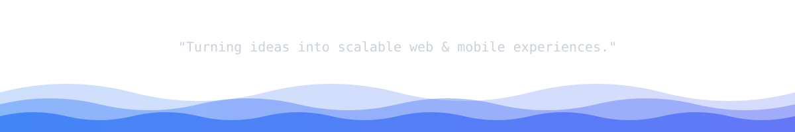

 

## Tentang Saya

Saya siswa **Rekayasa Perangkat Lunak SMK Telkom Malang** yang membangun produk digital di tiga bidang: **web, mobile, dan UI/UX**. Teknologi andalan saya **Next.js**, **Flutter**, dan **Supabase** untuk backend cloud. Saya terbiasa merancang sistem dengan autentikasi yang aman, manajemen data multi-role, dan integrasi API yang rapi sampai siap dipakai.

 

## Tech Stack

## Proyek & Pengalaman

<table>
<tr>
<td></td>
<td></td>
</tr>
<tr>
<td></td>
<td></td>
</tr>
</table>

## Sertifikasi & Prestasi

| Tahun | Pencapaian |
|:-----:|:-----------|
| 2026 | **Pelatihan AI Engineer & Intermediate Assistant Web Developer** — Digital Talent Scholarship |
| 2026 | **Web Creation Competition** |
| 2025 | 🥈 Finalis **Business Plan Competition** |
| 2024 | **UI/UX ISINDO CHAMPIONS** |
| — | Sertifikasi **Pengembangan Web Front-End** & **Membuat Website dengan React** — Dicoding |

## GitHub Activity

